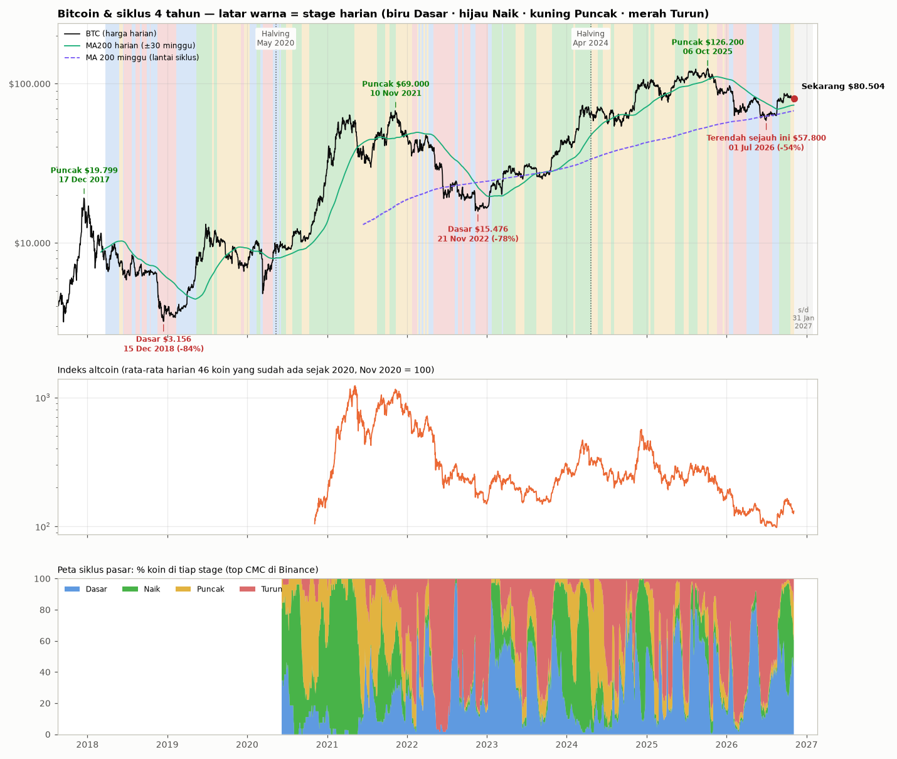

# 🔄 Siklus 4 Tahun Kripto

Dibuat 5 Nov 2026 21:22 WIB · BTC sejak 2017-08-17 · 131 koin lain sejak akhir 2019 · horizon 88 hari (s/d 2027-01-31)

## Posisi sekarang

- Harga BTC $80.504 · ATH $126.200 · **-36,2% dari ATH**
- Stage harian (MA200): **Stage 3 Puncak** — kenaikan tertahan, harga bolak-balik (distribusi)
- Stage mingguan (MA 30 minggu, Weinstein klasik): **Stage 2 Naik** (MA30 minggu $73.734, kemiringan 4 minggu +2,19%)
- MA200 harian $73.231 · MA 200 minggu $67.472
- 928 hari setelah halving April 2024 · 394 hari setelah puncak siklus (2025-10-06, $126.200) · ±528 hari ke halving berikutnya
- Peta pasar (127 koin): Dasar 47.2% · Naik 13.4% · Puncak 24.4% · Turun 15.0%
- Terendah siklus ini $57.800 (2026-07-01, 126 hari lalu) · sekarang +39,3% dari titik itu
- Indeks altcoin -76,7% dari puncak siklus ini (2024-12-06), +33,8% dari terendahnya (2026-08-16) · -89,3% dari puncak 2021

## Siklus halving

| Halving | Puncak | Hari halving→puncak | Dasar | Hari puncak→dasar | Turun |
|---|---|---|---|---|---|
| 2016-07-09 | 2017-12-17 · $19.799 | 526 | 2018-12-15 · $3.156 | 363 | -84,1% |
| 2020-05-11 | 2021-11-10 · $69.000 | 548 | 2022-11-21 · $15.476 | 376 | -77,6% |
| 2024-04-20 | 2025-10-06 · $126.200 | 534 | 2026-07-01 · $57.800 (terendah sejauh ini) | 268 | -54,2% |

Catatan: data Binance baru mulai 2017-08-17, jadi siklus 2016 dihitung dari tanggal itu.

## Posisi yang sama di siklus sebelumnya (horizon 88 hari)

| Siklus | Disejajarkan dari | Periode | Turun dari puncak saat itu | Dasar sudah lewat? | Hasil | Terendah | Tertinggi |
|---|---|---|---|---|---|---|---|
| 2016 | halving | 2019-01-23 → 2019-04-21 | -82,1% | ya | **+47,9%** | -5,7% | +52,6% |
| 2016 | puncak | 2019-01-15 → 2019-04-13 | -82,1% | ya | **+42,0%** | -5,7% | +52,6% |
| 2020 | halving | 2022-11-25 → 2023-02-21 | -76,1% | ya | **+48,0%** | -3,2% | +52,8% |
| 2020 | puncak | 2022-12-09 → 2023-03-07 | -75,2% | ya | **+29,6%** | -5,1% | +47,4% |

## Peluang dari sejarah: perubahan 88 hari ke depan

Setiap hari dalam sejarah dengan kondisi serupa dihitung hasilnya H hari kemudian. Hari-hari berurutan saling tumpang tindih, jadi sampel sebenarnya ±jumlah bulan.

| Kondisi | Aset | Hari (bulan) | Peluang naik | Median | Kisaran tengah (25–75%) | Naik ≥10% | Turun ≥10% |
|---|---|---|---|---|---|---|---|
| Semua hari sejak 2017 | BTC | 3279 (109) | **54.5%** | +4,3% | -16,5% s/d +33,6% | 43.9% | 34.6% |
| Semua hari sejak 2017 | Altcoin | 2103 (70) | **42.5%** | -7,9% | -26,3% s/d +26,8% | 34.8% | 47.5% |
| Semua hari sejak 2017 | ETH | 2473 (82) | **59.3%** | +10,2% | -17,4% s/d +44,1% | 50.2% | 31.6% |
| Stage harian BTC sama (Stage 3) | BTC | 947 (51) | **58.2%** | +7,4% | -13,6% s/d +37,9% | 47.2% | 30.2% |
| Stage harian BTC sama (Stage 3) | Altcoin | 720 (38) | **48.9%** | -1,6% | -25,8% s/d +44,8% | 42.4% | 41.0% |
| Stage harian BTC sama (Stage 3) | ETH | 843 (45) | **60.1%** | +17,1% | -21,6% s/d +46,2% | 53.3% | 31.3% |
| Stage mingguan BTC sama (Stage 2) | BTC | 1155 (49) | **55.5%** | +3,4% | -13,6% s/d +29,2% | 40.5% | 31.9% |
| Stage mingguan BTC sama (Stage 2) | Altcoin | 899 (37) | **40.8%** | -8,7% | -26,1% s/d +22,7% | 32.8% | 48.3% |
| Stage mingguan BTC sama (Stage 2) | ETH | 1024 (43) | **57.5%** | +5,8% | -16,2% s/d +54,0% | 47.5% | 31.2% |
| Turun 26–46% dari ATH | BTC | 659 (42) | **47.8%** | -4,1% | -22,1% s/d +38,5% | 41.1% | 46.1% |
| Turun 26–46% dari ATH | Altcoin | 499 (29) | **37.7%** | -16,4% | -31,4% s/d +22,8% | 32.5% | 57.3% |
| Turun 26–46% dari ATH | ETH | 582 (34) | **52.2%** | +3,6% | -26,5% s/d +41,6% | 46.2% | 42.8% |
| Harga di bawah MA200 yang menurun | BTC | 996 (41) | **43.3%** | -7,7% | -21,1% s/d +25,1% | 35.4% | 46.5% |
| Harga di bawah MA200 yang menurun | Altcoin | 601 (25) | **35.3%** | -14,2% | -27,8% s/d +11,9% | 26.6% | 54.9% |
| Harga di bawah MA200 yang menurun | ETH | 703 (30) | **48.6%** | -1,6% | -21,6% s/d +28,2% | 39.7% | 40.8% |
| Fase siklus sama: 319–469 hari setelah puncak siklus | BTC | 302 (11) | **81.8%** | +29,3% | +9,2% s/d +61,4% | 72.8% | 14.6% |
| Fase siklus sama: 319–469 hari setelah puncak siklus | Altcoin | 151 (6) | **53.0%** | +3,1% | -12,5% s/d +33,7% | 47.0% | 27.8% |
| Fase siklus sama: 319–469 hari setelah puncak siklus | ETH | 151 (6) | **86.1%** | +20,8% | +8,4% s/d +35,6% | 71.5% | 2.0% |
| Fase siklus sama: 853–1003 hari setelah halving | BTC | 302 (12) | **79.8%** | +30,7% | +7,7% s/d +64,7% | 71.2% | 16.2% |
| Fase siklus sama: 853–1003 hari setelah halving | Altcoin | 151 (6) | **53.0%** | +3,1% | -14,1% s/d +33,7% | 47.0% | 27.8% |
| Fase siklus sama: 853–1003 hari setelah halving | ETH | 151 (6) | **76.8%** | +20,7% | +1,2% s/d +35,6% | 66.9% | 7.9% |

## Musiman: tanggal yang sama tiap tahun (+88 hari)

| Periode | BTC | Altcoin |
|---|---|---|
| 04 Nov 2017 → 31 Jan 2018 | +39,8% | - |
| 04 Nov 2018 → 31 Jan 2019 | -47,1% | - |
| 04 Nov 2019 → 31 Jan 2020 | -0,4% | - |
| 04 Nov 2020 → 31 Jan 2021 | +134,0% | - |
| 04 Nov 2021 → 31 Jan 2022 | -37,3% | -47,9% |
| 04 Nov 2022 → 31 Jan 2023 | +9,3% | -11,2% |
| 04 Nov 2023 → 31 Jan 2024 | +21,4% | +21,7% |
| 04 Nov 2024 → 31 Jan 2025 | +51,0% | +75,6% |
| 04 Nov 2025 → 31 Jan 2026 | -22,4% | -31,7% |

## Keterbatasan

- Hanya 2–3 siklus halving yang tercatat; pola bisa berubah (ETF, suku bunga, regulasi).
- Indeks altcoin & peta pasar memakai koin top saat ini (survivorship bias: koin yang mati tidak ikut).
- Peluang = frekuensi masa lalu, bukan ramalan. Bukan ajakan beli/jual.
