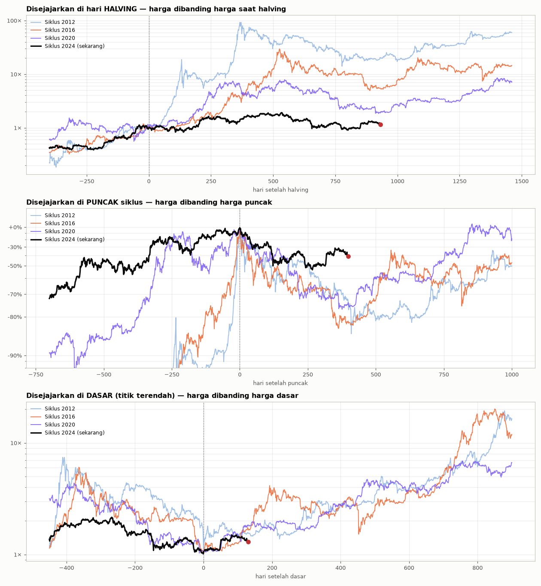

# 🔄 Siklus 4 Tahun Kripto

Dibuat 9 Nov 2026 09:32 WIB · BTC sejak 2011-08-18 · 130 koin lain sejak akhir 2019 · horizon 84 hari (s/d 2027-01-31)

## Posisi sekarang

- Harga BTC $74.851 · ATH $126.200 · **-40,7% dari ATH**
- Stage harian (MA200): **Stage 3 Puncak** — di lantai kisaran puncak, rawan jebol
- Stage mingguan (MA 30 minggu, Weinstein klasik): **Stage 1 Dasar** (MA30 minggu $73.545, kemiringan 4 minggu +1,93%)
- MA200 harian $73.224 · MA 200 minggu $67.760
- 932 hari setelah halving April 2024 · 398 hari setelah puncak siklus (2025-10-06, $126.200) · ±524 hari ke halving berikutnya
- Peta pasar (127 koin): Dasar 44.9% · Naik 8.7% · Puncak 29.9% · Turun 16.5%
- Terendah siklus ini $57.800 (2026-07-01, 130 hari lalu) · sekarang +29,5% dari titik itu
- Indeks altcoin -79,7% dari puncak siklus ini (2024-12-06), +22,6% dari terendahnya (2026-08-16) · -91,1% dari puncak 2021

## Siklus halving

| Halving | Puncak | Hari halving→puncak | Dasar | Hari puncak→dasar | Turun |
|---|---|---|---|---|---|
| 2012-11-28 | 2013-11-30 · $1.163 | 367 | 2015-01-14 · $152 | 410 | -86,9% |
| 2016-07-09 | 2017-12-17 · $19.799 | 526 | 2018-12-15 · $3.156 | 363 | -84,1% |
| 2020-05-11 | 2021-11-10 · $69.000 | 548 | 2022-11-21 · $15.476 | 376 | -77,6% |
| 2024-04-20 | 2025-10-06 · $126.200 | 534 | 2026-07-01 · $57.800 (terendah sejauh ini) | 268 | -54,2% |

Data BTC mulai 2011-08-18 (Bitstamp sebelum Agustus 2017, Binance sesudahnya).

## Perbandingan antar siklus

| Siklus | Harga saat halving | Puncak | Naik halving→puncak | Naik dari dasar sebelumnya | Hari halving→puncak | Turun puncak→dasar | Hari puncak→dasar | Pulih 130 hari setelah dasar | 398 hari setelah puncak | Kemiripan bentuk vs sekarang (dari halving / dari puncak) |
|---|---|---|---|---|---|---|---|---|---|---|
| 2012 | $12 | $1.163 (2013-11-30) | 95.2× | - | 367 | -86,9% | 410 | +57,0% | -72,9% | 0.55 / 0.26 |
| 2016 | $648 | $19.799 (2017-12-17) | 30.6× | 129.9× | 526 | -84,1% | 363 | +71,6% | -81,5% | 0.41 / 0.34 |
| 2020 | $8.562 | $69.000 (2021-11-10) | 8.1× | 21.9× | 548 | -77,6% | 376 | +83,9% | -74,2% | 0.73 / 0.75 |
| 2024 | $64.941 | $126.200 (2025-10-06) | 1.9× | 8.2× | 534 | -54,2% (sejauh ini) | 268 | +29,5% | -40,7% | - / - |

Kemiripan = korelasi bentuk grafik (log harga), 1 = identik, 0 = tidak mirip. Siklus lengkap satu sama lain (halving → ±1.300 hari): 2012 vs 2016 = 0.82; 2012 vs 2020 = 0.72; 2016 vs 2020 = 0.61

## Posisi yang sama di siklus sebelumnya (horizon 84 hari)

| Siklus | Disejajarkan dari | Periode | Turun dari puncak saat itu | Dasar sudah lewat? | Hasil | Terendah | Tertinggi |
|---|---|---|---|---|---|---|---|
| 2012 | halving | 2015-06-18 → 2015-09-10 | -78,6% | ya | **-3,9%** | -20,2% | +28,0% |
| 2012 | puncak | 2015-01-02 → 2015-03-27 | -72,9% | belum | **-21,4%** | -51,7% | +0,5% |
| 2016 | halving | 2019-01-27 → 2019-04-21 | -82,1% | ya | **+48,0%** | -5,7% | +52,7% |
| 2016 | puncak | 2019-01-19 → 2019-04-13 | -81,5% | ya | **+37,6%** | -8,6% | +47,9% |
| 2020 | halving | 2022-11-29 → 2023-02-21 | -76,2% | ya | **+48,7%** | -2,1% | +53,6% |
| 2020 | puncak | 2022-12-13 → 2023-03-07 | -74,2% | ya | **+24,9%** | -8,5% | +42,1% |

## Peluang dari sejarah: perubahan 84 hari ke depan

Setiap hari dalam sejarah dengan kondisi serupa dihitung hasilnya H hari kemudian. Hari-hari berurutan saling tumpang tindih, jadi sampel sebenarnya ±jumlah bulan.

| Kondisi | Aset | Hari (bulan) | Peluang naik | Median | Kisaran tengah (25–75%) | Naik ≥10% | Turun ≥10% |
|---|---|---|---|---|---|---|---|
| Semua hari sejak 2011 | BTC | 5478 (181) | **59.5%** | +9,8% | -14,3% s/d +45,2% | 49.9% | 30.4% |
| Semua hari sejak 2011 | Altcoin | 2111 (70) | **42.4%** | -7,0% | -25,7% s/d +25,7% | 34.8% | 46.7% |
| Semua hari sejak 2011 | ETH | 2481 (82) | **59.0%** | +9,2% | -17,3% s/d +43,2% | 49.6% | 31.6% |
| Stage harian BTC sama (Stage 3) | BTC | 1506 (79) | **60.1%** | +11,4% | -16,0% s/d +38,3% | 50.9% | 31.7% |
| Stage harian BTC sama (Stage 3) | Altcoin | 720 (38) | **47.4%** | -1,2% | -23,9% s/d +43,0% | 41.9% | 40.7% |
| Stage harian BTC sama (Stage 3) | ETH | 843 (45) | **60.0%** | +15,5% | -21,6% s/d +45,3% | 52.4% | 32.1% |
| Stage mingguan BTC sama (Stage 1) | BTC | 602 (30) | **67.4%** | +22,6% | -7,3% s/d +47,2% | 61.0% | 21.6% |
| Stage mingguan BTC sama (Stage 1) | Altcoin | 168 (9) | **62.5%** | +22,7% | -10,4% s/d +66,0% | 57.7% | 25.6% |
| Stage mingguan BTC sama (Stage 1) | ETH | 231 (12) | **90.0%** | +23,5% | +10,6% s/d +42,4% | 75.3% | 0.9% |
| Turun 31–51% dari ATH | BTC | 1229 (75) | **54.4%** | +8,6% | -19,3% s/d +34,9% | 49.3% | 36.9% |
| Turun 31–51% dari ATH | Altcoin | 540 (26) | **53.7%** | +5,4% | -23,4% s/d +31,9% | 45.7% | 39.3% |
| Turun 31–51% dari ATH | ETH | 660 (34) | **64.2%** | +19,8% | -16,7% s/d +43,7% | 58.5% | 30.3% |
| Harga di bawah MA200 yang menurun | BTC | 1385 (57) | **40.5%** | -7,7% | -21,7% s/d +20,1% | 31.5% | 47.9% |
| Harga di bawah MA200 yang menurun | Altcoin | 609 (25) | **35.3%** | -14,0% | -28,6% s/d +13,1% | 26.8% | 54.4% |
| Harga di bawah MA200 yang menurun | ETH | 711 (30) | **47.7%** | -2,9% | -21,8% s/d +29,2% | 40.5% | 41.1% |
| Fase siklus sama: 323–473 hari setelah puncak siklus | BTC | 453 (18) | **59.8%** | +8,9% | -13,4% s/d +42,7% | 48.3% | 30.9% |
| Fase siklus sama: 323–473 hari setelah puncak siklus | Altcoin | 151 (6) | **52.3%** | +8,5% | -13,0% s/d +32,1% | 48.3% | 30.5% |
| Fase siklus sama: 323–473 hari setelah puncak siklus | ETH | 151 (6) | **84.1%** | +21,4% | +7,7% s/d +33,5% | 70.9% | 2.0% |
| Fase siklus sama: 857–1007 hari setelah halving | BTC | 453 (18) | **74.2%** | +21,9% | -0,5% s/d +47,5% | 61.6% | 14.3% |
| Fase siklus sama: 857–1007 hari setelah halving | Altcoin | 151 (6) | **52.3%** | +8,5% | -14,1% s/d +32,1% | 48.3% | 30.5% |
| Fase siklus sama: 857–1007 hari setelah halving | ETH | 151 (6) | **75.5%** | +21,1% | +1,2% s/d +33,5% | 67.5% | 5.3% |

## Jangkauan harga BTC dalam 84 hari (data sejak Agustus 2017, dari harga $74.851)

| Kondisi | Hari | Terendah tersentuh (tengah / 10% terburuk) | Harga akhir (25% · median · 75%) | Tertinggi tersentuh (tengah / 10% terbaik) | Sentuh −10% / −20% | Sentuh +10% / +20% |
|---|---|---|---|---|---|---|
| Semua hari sejak 2017 | 3287 | $62.950 / $41.093 | $62.576 · $78.369 · $98.879 | $91.244 / $138.251 | 64.9% / 41.2% | 74.3% / 52.8% |
| Stage harian BTC sama (Stage 3) | 1067 | $60.480 / $46.483 | $61.977 · $77.322 · $97.756 | $92.217 / $126.200 | 67.6% / 48.7% | 74.9% / 54.2% |
| Stage mingguan BTC sama (Stage 1) | 406 | $65.645 / $49.627 | $69.013 · $87.726 · $107.562 | $104.642 / $138.775 | 56.4% / 30.3% | 94.1% / 80.8% |
| Fase siklus sama: 323–473 hari setelah puncak siklus | 302 | $69.387 / $56.513 | $80.540 · $98.579 · $118.265 | $106.963 / $169.539 | 43.4% / 18.5% | 84.4% / 68.5% |

## Musiman: tanggal yang sama tiap tahun (+84 hari)

| Periode | BTC | Altcoin |
|---|---|---|
| 08 Nov 2017 → 31 Jan 2018 | +40,8% | - |
| 08 Nov 2018 → 31 Jan 2019 | -47,0% | - |
| 08 Nov 2019 → 31 Jan 2020 | +6,6% | - |
| 08 Nov 2020 → 31 Jan 2021 | +113,8% | +143,8% |
| 08 Nov 2021 → 31 Jan 2022 | -43,0% | -50,6% |
| 08 Nov 2022 → 31 Jan 2023 | +24,7% | +6,3% |
| 08 Nov 2023 → 31 Jan 2024 | +19,5% | +13,5% |
| 08 Nov 2024 → 31 Jan 2025 | +33,9% | +46,0% |
| 08 Nov 2025 → 31 Jan 2026 | -23,0% | -40,0% |

## Keterbatasan

- Hanya 2–3 siklus halving yang tercatat; pola bisa berubah (ETF, suku bunga, regulasi).
- Indeks altcoin & peta pasar memakai koin top saat ini (survivorship bias: koin yang mati tidak ikut).
- Peluang = frekuensi masa lalu, bukan ramalan. Bukan ajakan beli/jual.
