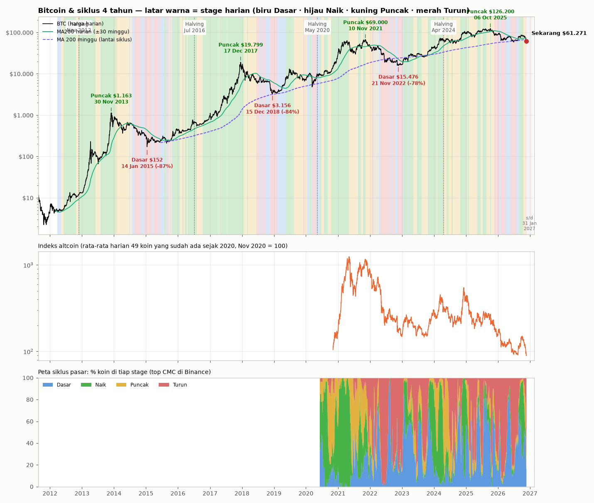
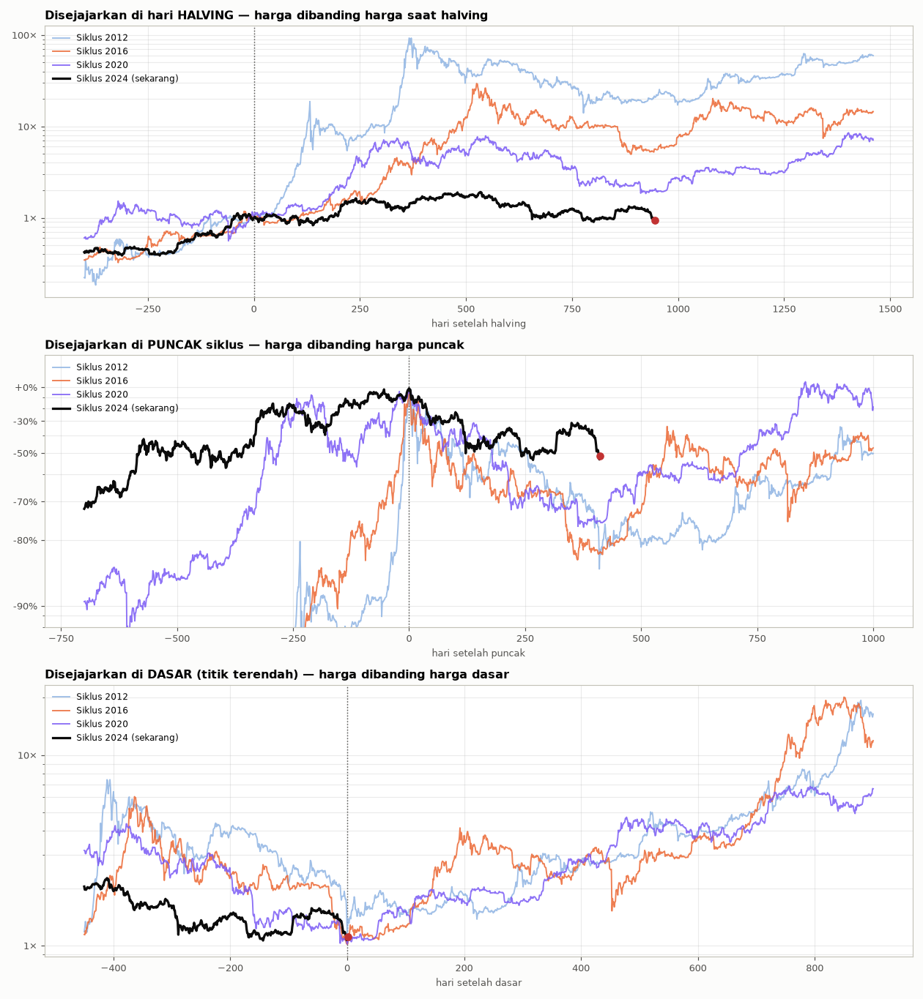

# 🔄 Siklus 4 Tahun Kripto

Dibuat 16 Nov 2026 09:40 WIB · BTC sejak 2011-08-18 · 132 koin lain sejak akhir 2019 · horizon 77 hari (s/d 2027-01-31)

## Posisi sekarang

- Harga BTC $65.351 · ATH $126.200 · **-48,2% dari ATH**
- Stage harian (MA200): **Stage 3 Puncak** — di lantai kisaran puncak, rawan jebol
- Stage mingguan (MA 30 minggu, Weinstein klasik): **Stage 1 Dasar** (MA30 minggu $73.263, kemiringan 4 minggu +0,88%)
- MA200 harian $72.978 · MA 200 minggu $67.983
- 939 hari setelah halving April 2024 · 405 hari setelah puncak siklus (2025-10-06, $126.200) · ±517 hari ke halving berikutnya
- Peta pasar (129 koin): Dasar 40.3% · Naik 2.3% · Puncak 27.1% · Turun 30.2%
- Terendah siklus ini $57.800 (2026-07-01, 137 hari lalu) · sekarang +13,1% dari titik itu
- Indeks altcoin -81,8% dari puncak siklus ini (2024-12-06), +7,6% dari terendahnya (2026-08-16) · -91,9% dari puncak 2021

## Siklus halving

| Halving | Puncak | Hari halving→puncak | Dasar | Hari puncak→dasar | Turun |
|---|---|---|---|---|---|
| 2012-11-28 | 2013-11-30 · $1.163 | 367 | 2015-01-14 · $152 | 410 | -86,9% |
| 2016-07-09 | 2017-12-17 · $19.799 | 526 | 2018-12-15 · $3.156 | 363 | -84,1% |
| 2020-05-11 | 2021-11-10 · $69.000 | 548 | 2022-11-21 · $15.476 | 376 | -77,6% |
| 2024-04-20 | 2025-10-06 · $126.200 | 534 | 2026-07-01 · $57.800 (terendah sejauh ini) | 268 | -54,2% |

Data BTC mulai 2011-08-18 (Bitstamp sebelum Agustus 2017, Binance sesudahnya).

## Perbandingan antar siklus

| Siklus | Harga saat halving | Puncak | Naik halving→puncak | Naik dari dasar sebelumnya | Hari halving→puncak | Turun puncak→dasar | Hari puncak→dasar | Pulih 137 hari setelah dasar | 405 hari setelah puncak | Kemiripan bentuk vs sekarang (dari halving / dari puncak) |
|---|---|---|---|---|---|---|---|---|---|---|
| 2012 | $12 | $1.163 (2013-11-30) | 95.2× | - | 367 | -86,9% | 410 | +50,2% | -74,7% | 0.55 / 0.25 |
| 2016 | $648 | $19.799 (2017-12-17) | 30.6× | 129.9× | 526 | -84,1% | 363 | +70,6% | -82,0% | 0.41 / 0.34 |
| 2020 | $8.562 | $69.000 (2021-11-10) | 8.1× | 21.9× | 548 | -77,6% | 376 | +80,3% | -75,5% | 0.73 / 0.75 |
| 2024 | $64.941 | $126.200 (2025-10-06) | 1.9× | 8.2× | 534 | -54,2% (sejauh ini) | 268 | +13,1% | -48,2% | - / - |

Kemiripan = korelasi bentuk grafik (log harga), 1 = identik, 0 = tidak mirip. Siklus lengkap satu sama lain (halving → ±1.300 hari): 2012 vs 2016 = 0.82; 2012 vs 2020 = 0.72; 2016 vs 2020 = 0.61

## Posisi yang sama di siklus sebelumnya (horizon 77 hari)

| Siklus | Disejajarkan dari | Periode | Turun dari puncak saat itu | Dasar sudah lewat? | Hasil | Terendah | Tertinggi |
|---|---|---|---|---|---|---|---|
| 2012 | halving | 2015-06-25 → 2015-09-10 | -79,2% | ya | **-1,4%** | -18,1% | +31,4% |
| 2012 | puncak | 2015-01-09 → 2015-03-27 | -74,7% | belum | **-15,7%** | -48,2% | +5,4% |
| 2016 | halving | 2019-02-03 → 2019-04-21 | -82,5% | ya | **+52,0%** | -2,5% | +56,8% |
| 2016 | puncak | 2019-01-26 → 2019-04-13 | -82,0% | ya | **+41,5%** | -6,0% | +52,1% |
| 2020 | halving | 2022-12-06 → 2023-02-21 | -75,2% | ya | **+43,1%** | -4,9% | +47,8% |
| 2020 | puncak | 2022-12-20 → 2023-03-07 | -75,5% | ya | **+31,4%** | -3,3% | +49,4% |

## Peluang dari sejarah: perubahan 77 hari ke depan

Setiap hari dalam sejarah dengan kondisi serupa dihitung hasilnya H hari kemudian. Hari-hari berurutan saling tumpang tindih, jadi sampel sebenarnya ±jumlah bulan.

| Kondisi | Aset | Hari (bulan) | Peluang naik | Median | Kisaran tengah (25–75%) | Naik ≥10% | Turun ≥10% |
|---|---|---|---|---|---|---|---|
| Semua hari sejak 2011 | BTC | 5492 (181) | **59.1%** | +9,0% | -13,6% s/d +41,4% | 49.1% | 30.1% |
| Semua hari sejak 2011 | Altcoin | 2125 (70) | **44.4%** | -5,6% | -24,3% s/d +23,8% | 33.3% | 44.6% |
| Semua hari sejak 2011 | ETH | 2495 (82) | **57.3%** | +9,1% | -15,8% s/d +41,4% | 49.5% | 31.7% |
| Stage harian BTC sama (Stage 3) | BTC | 1506 (79) | **59.0%** | +10,4% | -13,6% s/d +35,8% | 50.5% | 31.8% |
| Stage harian BTC sama (Stage 3) | Altcoin | 720 (38) | **50.0%** | -0,0% | -21,4% s/d +34,3% | 37.2% | 39.9% |
| Stage harian BTC sama (Stage 3) | ETH | 843 (45) | **59.7%** | +13,8% | -19,8% s/d +43,5% | 53.3% | 32.1% |
| Stage mingguan BTC sama (Stage 1) | BTC | 610 (31) | **66.9%** | +21,8% | -8,7% s/d +45,2% | 60.8% | 24.3% |
| Stage mingguan BTC sama (Stage 1) | Altcoin | 176 (10) | **61.9%** | +13,5% | -8,7% s/d +53,8% | 54.5% | 23.9% |
| Stage mingguan BTC sama (Stage 1) | ETH | 239 (13) | **85.8%** | +24,0% | +11,2% s/d +41,6% | 75.7% | 5.0% |
| Turun 38–58% dari ATH | BTC | 1505 (81) | **52.0%** | +2,9% | -18,5% s/d +26,4% | 43.7% | 37.5% |
| Turun 38–58% dari ATH | Altcoin | 525 (27) | **52.0%** | +2,3% | -17,3% s/d +29,8% | 39.2% | 35.8% |
| Turun 38–58% dari ATH | ETH | 770 (38) | **59.9%** | +12,7% | -12,0% s/d +45,6% | 52.6% | 27.9% |
| Harga di bawah MA200 yang menurun | BTC | 1387 (57) | **41.5%** | -7,5% | -20,9% s/d +19,9% | 32.3% | 46.8% |
| Harga di bawah MA200 yang menurun | Altcoin | 611 (25) | **38.3%** | -13,4% | -27,1% s/d +13,2% | 27.7% | 52.4% |
| Harga di bawah MA200 yang menurun | ETH | 713 (30) | **45.4%** | -3,8% | -21,8% s/d +31,4% | 39.8% | 41.4% |
| Fase siklus sama: 330–480 hari setelah puncak siklus | BTC | 453 (18) | **61.4%** | +11,3% | -12,7% s/d +40,9% | 50.3% | 28.5% |
| Fase siklus sama: 330–480 hari setelah puncak siklus | Altcoin | 151 (6) | **56.3%** | +9,0% | -16,7% s/d +32,2% | 49.0% | 35.1% |
| Fase siklus sama: 330–480 hari setelah puncak siklus | ETH | 151 (6) | **81.5%** | +21,5% | +10,4% s/d +30,6% | 74.8% | 0.7% |
| Fase siklus sama: 864–1014 hari setelah halving | BTC | 453 (18) | **74.2%** | +21,5% | -0,3% s/d +45,2% | 64.7% | 15.5% |
| Fase siklus sama: 864–1014 hari setelah halving | Altcoin | 151 (6) | **56.3%** | +9,0% | -17,4% s/d +32,2% | 49.0% | 35.1% |
| Fase siklus sama: 864–1014 hari setelah halving | ETH | 151 (6) | **72.2%** | +21,5% | -1,3% s/d +30,6% | 68.9% | 3.3% |

## Jangkauan harga BTC dalam 77 hari (data sejak Agustus 2017, dari harga $65.351)

| Kondisi | Hari | Terendah tersentuh (tengah / 10% terburuk) | Harga akhir (25% · median · 75%) | Tertinggi tersentuh (tengah / 10% terbaik) | Sentuh −10% / −20% | Sentuh +10% / +20% |
|---|---|---|---|---|---|---|
| Semua hari sejak 2017 | 3301 | $55.548 / $37.381 | $55.418 · $67.900 · $85.283 | $78.879 / $117.763 | 63.4% / 39.0% | 73.2% / 51.0% |
| Stage harian BTC sama (Stage 3) | 1067 | $53.653 / $41.367 | $55.548 · $67.181 · $83.780 | $79.663 / $107.176 | 66.7% / 45.5% | 73.9% / 52.9% |
| Stage mingguan BTC sama (Stage 1) | 414 | $58.097 / $45.550 | $59.535 · $77.572 · $92.668 | $90.446 / $116.063 | 53.9% / 27.5% | 93.0% / 78.7% |
| Fase siklus sama: 330–480 hari setelah puncak siklus | 302 | $60.711 / $50.516 | $69.926 · $86.786 · $98.615 | $92.733 / $143.511 | 41.1% / 14.6% | 84.4% / 71.2% |

## Musiman: tanggal yang sama tiap tahun (+77 hari)

| Periode | BTC | Altcoin |
|---|---|---|
| 15 Nov 2017 → 31 Jan 2018 | +42,1% | - |
| 15 Nov 2018 → 31 Jan 2019 | -40,3% | - |
| 15 Nov 2019 → 31 Jan 2020 | +10,4% | - |
| 15 Nov 2020 → 31 Jan 2021 | +107,4% | +128,2% |
| 15 Nov 2021 → 31 Jan 2022 | -39,5% | -48,9% |
| 15 Nov 2022 → 31 Jan 2023 | +36,8% | +22,5% |
| 15 Nov 2023 → 31 Jan 2024 | +12,5% | +2,5% |
| 15 Nov 2024 → 31 Jan 2025 | +12,5% | +28,6% |
| 15 Nov 2025 → 31 Jan 2026 | -17,6% | -35,0% |

## Keterbatasan

- Hanya 2–3 siklus halving yang tercatat; pola bisa berubah (ETF, suku bunga, regulasi).
- Indeks altcoin & peta pasar memakai koin top saat ini (survivorship bias: koin yang mati tidak ikut).
- Peluang = frekuensi masa lalu, bukan ramalan. Bukan ajakan beli/jual.
